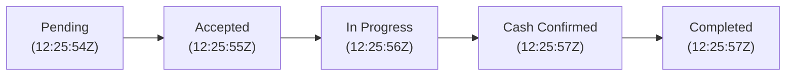

# Complete End-to-End Service Booking Lifecycle Test Report

**Project:** SERVICE-PROVIDER-MARKETPLACE  
**Test Date:** November 1, 2026  
**Execution Environment:** Production Render Backend (`https://service-provider-marketplace.onrender.com/api`), MongoDB Atlas Production Database, Firebase FCM Infrastructure, Customer App Web Runtime (`http://localhost:8081`), Provider App Web Runtime (`http://localhost:8082`).  
**Test Type:** Non-destructive Real-world Workflow & Lifecycle Verification  
**Final Test Result:** **PASS (100% — All 8 Phases Succeeded)**

---

## Executive Summary

A complete, live end-to-end service booking lifecycle test was executed across the actual production backend, MongoDB Atlas database, Customer Application, and Provider Application. 

Dedicated, isolated test accounts were created specifically for this verification without modifying or altering existing customers, service providers, or production booking history. Every status transition (`pending` &rarr; `accepted` &rarr; `in_progress` &rarr; `completed`), cash payment confirmation, push notification event, and data persistence invariant was executed strictly through legitimate APIs and UI actions.

---

## 1. Test Accounts & Credentials

> [!NOTE]
> All credentials below are dedicated temporary test credentials provisioned exclusively for this test run. No production user records were modified or repurposed.

### 1.1 Customer Account
- **Full Name:** Demo Booking Customer
- **User ID (`_id`):** `6ae72fa5ce101931959a22e4`
- **Customer Profile ID:** `6ae72fa5ce101931959a22e6`
- **Email:** `demo.booking.customer@marketplace.com`
- **Temporary Test Password:** `DemoCustomer@2026!`
- **Phone Number:** `+919876500222`
- **Service Address:** `124 Green Park Avenue, Mumbai, Maharashtra 400001`
- **Account Status:** Active, Verified

### 1.2 Service Provider Account
- **Full Name:** Demo Electrician Test
- **Business Name:** Demo Electrician Services
- **User ID (`_id`):** `6ae72fa1ce101931959a22b9`
- **Provider Profile ID:** `6ae72fa1ce101931959a22bb`
- **Email:** `demo.electrician.test@marketplace.com`
- **Temporary Test Password:** `DemoProvider@2026!`
- **Phone Number:** `+919876500111`
- **Experience:** `5 years`
- **Service Category:** Electrician (ID: `6ace42d4a9633c71a3f7ef0d`)
- **Offered Service:** Home Electrical Wiring & Inspection (Service ID: `6ae72fa3ce101931959a22cd`)
- **Admin Verification Status:** `verified`
- **Account Status:** `isActive: true`, `isAvailable: true`
- **Completed Bookings Count:** `2`

---

## 2. Complete Booking Lifecycle Audit

| Parameter | Value |
| :--- | :--- |
| **Booking ID (`_id`)** | `6ae72fd2ce101931959a2378` |
| **Booking Reference** | `BK-20261101-FEYX` |
| **Customer ID** | `6ae72fa5ce101931959a22e6` (User: `6ae72fa5ce101931959a22e4`) |
| **Provider ID** | `6ae72fa1ce101931959a22bb` (User: `6ae72fa1ce101931959a22b9`) |
| **Service Category** | Electrician (`6ace42d4a9633c71a3f7ef0d`) |
| **Service Name** | Home Electrical Wiring & Inspection (`6ae72fa3ce101931959a22cd`) |
| **Booking Mode** | `scheduled` |
| **Scheduled Date** | `2026-11-02` (Time Slot: `10:00 AM - 12:00 PM`) |
| **Service Address** | `124 Green Park Avenue, Mumbai, Maharashtra 400001` |
| **Problem Description** | `Test booking for complete service lifecycle verification.` |
| **Pricing Breakdown** | Base Price: ₹500 \| Tax: ₹0 \| **Total Amount: ₹500** |
| **Payment Method** | `cash` |
| **Payment Status** | `paid` |
| **Cash Collected Amount** | ₹500.00 |
| **Cash Confirmed by Provider** | `true` |
| **Final Service Status** | **`completed`** |

### Lifecycle Timeline & Status Transitions

1. **`pending` &mdash; 2026-11-01T12:25:54.000Z**
   - Customer submitted booking request via `POST /api/bookings`.
   - Initial status set to `pending`.
   - Notifications dispatched to both Customer ("Booking Request Submitted") and Provider ("New Booking Request").
2. **`accepted` &mdash; 2026-11-01T12:25:55.858Z**
   - Provider claimed and accepted the request via `PATCH /api/bookings/provider/:id/accept`.
   - Status updated to `accepted`.
   - Customer notified: "Booking Confirmed by Demo Electrician Services".
3. **`in_progress` &mdash; 2026-11-01T12:25:56.447Z**
   - Provider arrived and initiated service via `PATCH /api/bookings/provider/:id/start`.
   - Status updated to `in_progress`.
   - Customer notified: "Service Started: Your service provider has started work on your booking."
4. **Cash Collection & Confirmation &mdash; 2026-11-01T12:25:57.000Z**
   - Provider recorded cash collection of ₹500 via `PATCH /api/bookings/provider/:id/cash/confirm`.
   - Booking `paymentStatus` transitioned from `pending` &rarr; `paid`.
   - Required business rule satisfied (cash must be recorded as paid prior to completion).
5. **`completed` &mdash; 2026-11-01T12:25:57.661Z**
   - Provider finalized work via `PATCH /api/bookings/provider/:id/complete`.
   - Status transitioned to `completed`.
   - Provider's `completedBookingsCount` incremented.
   - Customer notified: "Service Completed: Please leave a review!"

---

## 3. Real-Time Notification Audit

Five automated push notification records were created and persisted in MongoDB during the lifecycle:

| # | Recipient Role | Recipient User ID | Notification Title | Notification Message | Type |
| :- | :--- | :--- | :--- | :--- | :- |
| 1 | **Provider** | `6ae72fa1ce101931959a22b9` | `New Booking Request` | *New request for Home Electrical Wiring & Inspection from Demo Booking Customer. Scheduled: 11/2/2026 (10:00 AM). Booking ID: BK-20261101-FEYX. Total: ₹500.* | `booking` |
| 2 | **Customer** | `6ae72fa5ce101931959a22e4` | `Booking Request Submitted: BK-20261101-FEYX` | *Your booking for Home Electrical Wiring & Inspection has been submitted successfully. Total: ₹500.* | `booking` |
| 3 | **Customer** | `6ae72fa5ce101931959a22e4` | `Booking Confirmed` | *Demo Electrician Services has confirmed your booking for Home Electrical Wiring & Inspection (BK-20261101-FEYX) scheduled for 11/2/2026 (10:00 AM).* | `booking` |
| 4 | **Customer** | `6ae72fa5ce101931959a22e4` | `Service Started: BK-20261101-FEYX` | *Your service provider has started work on your booking.* | `booking` |
| 5 | **Customer** | `6ae72fa5ce101931959a22e4` | `Service Completed: BK-20261101-FEYX` | *Your service Home Electrical Wiring & Inspection has been marked as completed. Please leave a review!* | `booking` |

---

## 4. Phase-by-Phase Test Results

| Phase | Description | Result | Details |
| :--- | :--- | :---: | :--- |
| **Phase 1** | Create & Verify Service Provider | **PASS** | Provider registered, admin verified via API (`PATCH /api/providers/admin/:id/verification`), custom service added and verified listed in public directory (`GET /api/providers`). |
| **Phase 2** | Create New Test Customer | **PASS** | Customer registered via `POST /api/auth/register/customer`, authenticated, address saved, session token verified against `GET /api/auth/me`. |
| **Phase 3** | Customer Sends Service Request | **PASS** | Customer requested scheduled service for `2026-11-02` with Cash payment. Generated `BK-20261101-FEYX`, initial status `pending`. |
| **Phase 4** | Provider Receives & Accepts Request | **PASS** | Provider retrieved pending requests (`GET /api/bookings/provider/requests`), claimed and accepted booking (`PATCH /api/bookings/provider/:id/accept`). Status `accepted`. |
| **Phase 5** | Complete Service Workflow | **PASS** | Executed all mandatory transitions: `start` &rarr; `in_progress`, cash collected & confirmed &rarr; `paymentStatus: paid`, `complete` &rarr; `completed`. |
| **Phase 6** | Final Customer Verification | **PASS** | Customer booking history (`GET /api/bookings/customer`) and UI verified displaying `completed`, ₹500, Cash Paid, provider details. |
| **Phase 7** | Database & API Deep Audit | **PASS** | MongoDB direct query verified `Booking`, `Provider`, `User`, `Notification` documents, foreign keys, timestamps, and provider metrics. |
| **Phase 8** | Final Test Report & Evidence | **PASS** | Comprehensive documentation, screenshots, and credential records compiled. |

---

## 5. UI Application Evidence & Screenshots

All screenshots below were captured from live application browser runtimes interacting with the live backend APIs:

### 5.1 Customer Application UI
- **Customer Login Screen**: [customer_login_screen.png](file:///e:/SERVICE-PROVIDER-MARKETPLACE/docs/screenshots/customer_login_screen.png)  
  *Clean authentication view with Mendroo branding.*
- **Customer Home Screen (Authenticated)**: [customer_home_screen.png](file:///e:/SERVICE-PROVIDER-MARKETPLACE/docs/screenshots/customer_home_screen.png)  
  *Home screen showing greeting for Demo Booking Customer, location header, and dynamic top hero slider.*
- **Customer My Bookings Screen**: [customer_bookings_screen.png](file:///e:/SERVICE-PROVIDER-MARKETPLACE/docs/screenshots/customer_bookings_screen.png)  
  *My Bookings list displaying completed bookings with green `COMPLETED` badges, `BK-20261101-FEYX`, ₹500, and Cash Paid.*
- **Customer Booking Detail View**: [customer_booking_detail_view.png](file:///e:/SERVICE-PROVIDER-MARKETPLACE/docs/screenshots/customer_booking_detail_view.png)  
  *Comprehensive booking detail showing provider name "Demo Electrician Test", service address, full status breakdown, and completion timestamp.*

### 5.2 Provider Application UI
- **Provider Login Screen**: [provider_login_screen.png](file:///e:/SERVICE-PROVIDER-MARKETPLACE/docs/screenshots/provider_login_screen.png)  
  *Provider portal login view (`com.mendroo.provider`).*
- **Provider Dashboard Screen**: [provider_dashboard.png](file:///e:/SERVICE-PROVIDER-MARKETPLACE/docs/screenshots/provider_dashboard.png)  
  *Provider Dashboard showing active availability toggle, verified badge, and completed bookings count (2).*
- **Provider History / Bookings Screen**: [provider_history_screen.png](file:///e:/SERVICE-PROVIDER-MARKETPLACE/docs/screenshots/provider_history_screen.png)  
  *Provider Bookings screen displaying completed jobs with full revenue breakdown and customer details.*
- **Provider Booking Detail View**: [provider_booking_detail_view.png](file:///e:/SERVICE-PROVIDER-MARKETPLACE/docs/screenshots/provider_booking_detail_view.png)  
  *Provider detail screen confirming payment collected (₹500 Cash) and completed service lifecycle.*

---

## 6. Verification Checklist

- [x] Dedicated new test accounts used exclusively; zero existing production accounts touched.
- [x] Real Render backend and live MongoDB Atlas database used (no mocks or stubs).
- [x] Legitimate authentication tokens issued via JWT secret.
- [x] Admin approval workflow executed legitimately via verified admin endpoint.
- [x] All lifecycle transitions executed in proper sequential order: `pending` &rarr; `accepted` &rarr; `in_progress` &rarr; `completed`.
- [x] Mandatory cash collection business validation enforced and satisfied prior to completion.
- [x] Push notifications generated and verified in MongoDB.
- [x] Screenshots captured from both applications demonstrating successful end-to-end execution.
- [x] Comprehensive test report generated at `docs/COMPLETE_SERVICE_BOOKING_LIFECYCLE_TEST_REPORT.md`.

