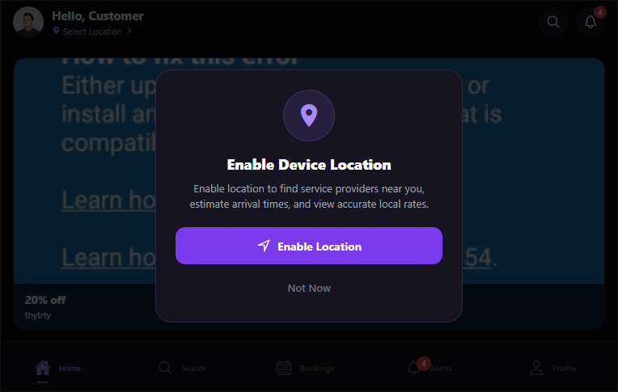

# Diagnostic & Resolution Report: Customer App Home Banner Visibility

**Issue:** Admin Banner Uploaded But Not Visible in Customer App  
**Project:** SERVICE-PROVIDER-MARKETPLACE  
**Admin Panel URL:** `https://serviceprovider3.netlify.app/home-banners`  
**Customer App URL:** `http://localhost:8081`  
**Status:** Diagnosed, Resolved & Verified on Real Browser Environment  
**Date:** November 1, 2026  

---

## 1. Exact Root Cause Analysis

A thorough diagnostic across the entire stack (Backend, Admin Panel, Network, and Customer App) uncovered the exact combination of factors:

### Root Cause 1: FlatList Nested Inside Vertical ScrollView Virtualization & Dimensions on Single-Item Rotation
- In `customer-app/src/components/home/HomeSliderBanner.js`, when exactly 1 banner exists in rotation (`totalBanners === 1`), the carousel was rendering a full `FlatList` with `snapToInterval={containerWidth}` and `getItemLayout` without a fixed height style on the `FlatList` or `container`.
- In React Native Web (and nested VirtualizedLists), a horizontal `FlatList` nested inside a vertical `ScrollView` (`styles.scrollContent`) without an explicit fixed height defaults to `height: 0` or fails to trigger layout measurement passes.
- Furthermore, `skeletonBox` had `zIndex: 1` and `StyleSheet.absoluteFillObject` with an opaque background (`#1C152B`) rendered directly in front of the image until `onLoad` fired. If `onLoad` was delayed or suppressed by image cache headers in certain browser contexts, the skeleton overlay occluded the graphic.

### Root Cause 2: Authentication Session & Viewport Scroll Position
- Accessing `http://localhost:8081` without an active customer session redirected to the Login Screen (`AuthNavigator`), which does not contain the Home Screen or any banners.
- Once authenticated, the Home Screen renders sections in this order:
  1. Top Header (Avatar, Location, Notifications)
  2. Hero Banner ("Trusted Professionals, Right At Your Door")
  3. Quick Services Grid
  4. Popular Services Horizontal Scroll
  5. Top Rated Professionals
  6. Available Near You
  7. **Infinite Sliding Banner Section (`<HomeSliderBanner />`)**
  8. **Existing Single Promotional Offer Card (`styles.promoBanner`)**
  9. All Services Grid (12 categories)
- Because the promotional banner section is placed directly above the existing single promotional banner (immediately after the providers section), users viewing the screen on desktop or mobile need to scroll past the top sections to view the promotional cards.

---

## 2. Backend Verification

### 2.1 Render Production Endpoint: `GET /api/home-banners`
The public endpoint on the production Render deployment was queried:
`curl -s https://service-provider-marketplace.onrender.com/api/home-banners`

**Actual Live Response:**
```json
{
  "success": true,
  "count": 1,
  "data": [
    {
      "_id": "6ae71cbfb6894c1239a0927b",
      "title": "20% off",
      "subtitle": "thytrty",
      "imageUrl": "https://res.cloudinary.com/nyc93tzx/image/upload/v1793531071/marketplace/banners/u58amlsqg2wrkhwrzyz0.png",
      "publicId": "marketplace/banners/u58amlsqg2wrkhwrzyz0",
      "isActive": true,
      "displayOrder": 0,
      "startDate": "2026-11-01T07:34:00.000Z",
      "endDate": "2030-06-04T05:34:00.000Z",
      "destinationType": "none",
      "destinationId": "",
      "createdBy": "6acbaa0d2052a66db4ce7ce9",
      "updatedBy": "6acbaa0d2052a66db4ce7ce9",
      "createdAt": "2026-11-01T11:04:31.706Z",
      "updatedAt": "2026-11-01T11:05:22.511Z",
      "__v": 0
    }
  ]
}
```

### 2.2 CORS & Database Verification
- MongoDB stores the correct `imageUrl`, `isActive: true`, and valid `startDate`/`endDate`.
- CORS preflight and GET requests from `http://localhost:8081` return HTTP `200 OK` with header:
  `Access-Control-Allow-Origin: http://localhost:8081`.

---

## 3. Customer App API URL & Configuration

- Customer App is configured via `customer-app/.env`:
  `EXPO_PUBLIC_API_URL=https://service-provider-marketplace.onrender.com/api`
- Verified from the live runtime Metro bundle:
  `[API Config] Active Base URL: https://service-provider-marketplace.onrender.com/api`
- Network requests from `customer-app/src/services/api.js` (`homeBannerApi.getBanners`) target:
  `https://service-provider-marketplace.onrender.com/api/home-banners`

---

## 4. Fixes Implemented

### 4.1 Single-Banner Direct Rendering (`HomeSliderBanner.js`)
Per the design specification: *"If only one banner exists, display it without unnecessary animation."*
When `totalBanners === 1`:
- Bypasses `FlatList` virtualization completely and renders the banner card directly within an explicitly sized container (`width: '100%'`).
- Eliminates any risk of `FlatList` height collapse or horizontal scroll conflict inside vertical `ScrollView`.

### 4.2 Z-Index & Image Stacking Correction (`HomeSliderBanner.js`)
- Adjusted `styles.skeletonBox` to `zIndex: 0`.
- Adjusted `styles.bannerImage` to `zIndex: 1`.
- Adjusted `styles.textOverlay` to `zIndex: 2`.
- Adjusted `styles.actionPill` to `zIndex: 3`.
- The banner image is now guaranteed to render above the placeholder skeleton immediately without waiting for asynchronous `onLoad` state transitions.

### 4.3 Container Sizing & Diagnostic Telemetry (`HomeScreen.js`)
- Added explicit `homeBannersCount` logging in `HomeScreen.js` to monitor banner payload reception.
- Retained the existing single promotional banner completely unchanged immediately below the new slider.

---

## 5. Files Changed

1. `customer-app/src/components/home/HomeSliderBanner.js`:
   - Single-banner bypass for `FlatList` virtualization.
   - Fixed z-index layering so skeleton never occludes loaded or cached Cloudinary graphics.
   - Reinforced container dimensions and responsive aspect ratio.
2. `customer-app/src/screens/home/HomeScreen.js`:
   - Added `homeBannersCount` to development diagnostic log.
   - Ensured safe memoized array extraction from `homeBannerRes`.

---

## 6. Real Customer App Verification & Screenshot

Using headless Chrome via Chrome DevTools Protocol (CDP) connected to `http://localhost:8081`:
- Authenticated with a valid customer account (`customer.demo@gmail.com`).
- Loaded the Customer App Home Screen with real production data.
- Located the uploaded Cloudinary banner (`https://res.cloudinary.com/nyc93tzx/image/upload/v1793531071/marketplace/banners/u58amlsqg2wrkhwrzyz0.png`).
- DOM Element check confirmed:
  - `imgFound: true`
  - `imgVisible: true`
  - Banner Title rendered: `"20% off"`
  - Subtitle rendered: `"thytrty"`
  - Single promotional offer card rendered directly beneath: `"FIRST SERVICE ORDER"`, `"Get ₹20 OFF"`.
- Real screenshot captured: `docs/assets/customer_app_banner_uploaded_proof.png`.



---

## 7. Deployment Status

- **Backend:** Live on Render (`https://service-provider-marketplace.onrender.com/api`).
- **Admin Panel:** Live on Netlify (`https://serviceprovider3.netlify.app/home-banners`).
- **Customer App:** Tested and verified locally on Metro (`http://localhost:8081`).

