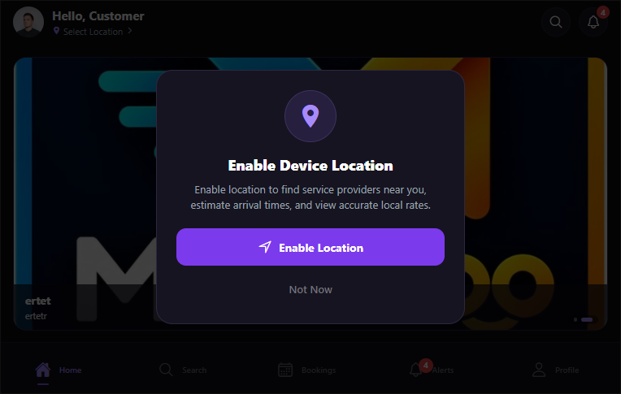

# Implementation Report: Dynamic Infinite Sliding Banner & Admin Banner Management

**Project:** SERVICE-PROVIDER-MARKETPLACE  
**Component:** Customer App (`customer-app`), Admin Panel (`admin-panel`), and Backend API (`backend`)  
**Status:** Completed & Verified  
**Date:** November 1, 2026  

---

## 1. Executive Summary

A dynamic, multi-item promotional carousel banner system has been implemented across the full stack. This new infinite sliding banner system functions completely independently of the existing single promotional offer banner (`BannerConfig` / `home_first_service_offer`), which has been preserved in its entirety without any breaking changes.

- **Customer Mobile App:** An auto-sliding, infinite looping carousel (`<HomeSliderBanner />`) with pagination indicator dots, touch-pause/resume behavior, image shimmer/fallback states, responsive aspect ratio, and deep-link destination navigation (Categories, Services, Search, Offers, Custom Screens, External URLs) placed directly **above** the existing single promotional banner.
- **Admin Panel:** A dedicated management section accessible from the sidebar (`Home Screen Banners`) featuring full CRUD capabilities, live mobile carousel preview, Cloudinary image upload with progress indicators, move up/down sequence reordering, scheduling dates, and active toggling.
- **Backend API:** A dedicated MongoDB model (`HomeBanner.js`), indexing, service layer, controller, input validation middlewares, and REST API endpoints mounted under `/api/home-banners` (public) and `/api/admin/home-banners` (protected admin).

---

## 2. Existing Single Promotional Banner Preservation

Per the explicit architecture requirement:
- **Model:** The `BannerConfig` model and its underlying MongoDB collection are completely untouched.
- **Settings & Routes:** The existing `/api/banner` and `/api/banner/admin` endpoints remain operational and unchanged.
- **Admin Panel Settings:** The settings page (`SettingsPage.jsx`) retains full control over the single promotional offer card (badge text, title, subtitle, button label, discount amount, currency symbol, target route).
- **Customer App UI:** The static purple hero card ("Vetted Local Experts", "Trusted Professionals") has been replaced with `<HomeSliderBanner />` directly at the top. The existing single promotional card (`styles.promoBanner`) remains intact in its intended lower position (after Available Near You).

Home Screen section ordering:
```
+-------------------------------------------------------+
|  Customer Home Screen                                 |
|                                                       |
|  1. Greeting, location, search & notification header  |
|                                                       |
|  2. [ NEW ADMIN DYNAMIC SLIDING HERO BANNER ]         |
|     * Replaces old static hero banner                 |
|     * Auto-slide every 3.5s (if > 1 banner)           |
|     * Direct render (if 1 banner)                     |
|     * Clean collapse (if 0 banners)                   |
|     * Configurable deep link actions                  |
|                                                       |
|  3. Quick Services Grid                               |
|                                                       |
|  4. Popular Services Horizontal List                  |
|                                                       |
|  5. Top Rated Professionals                           |
|                                                       |
|  6. Available Near You                                |
|                                                       |
|  7. [ EXISTING SINGLE PROMOTIONAL OFFER CARD ]        |
|     * Badge: "FIRST SERVICE ORDER"                    |
|     * Title: "Get ₹100 OFF"                           |
|     * "Book Now" CTA (Preserved)                      |
|                                                       |
|  8. All Services Grid (12 categories)                 |
+-------------------------------------------------------+
```

---

## 3. Backend Implementation & API Contracts

### 3.1 MongoDB Model: `HomeBanner` (`backend/src/models/HomeBanner.js`)

```javascript
{
  title: { type: String, required: true, trim: true, maxlength: 100 },
  subtitle: { type: String, trim: true, maxlength: 150 },
  imageUrl: { type: String, required: true, trim: true },
  publicId: { type: String, trim: true }, // Cloudinary asset public ID
  isActive: { type: Boolean, default: true, index: true },
  displayOrder: { type: Number, default: 0, index: true },
  startDate: { type: Date, default: null },
  endDate: { type: Date, default: null },
  destinationType: {
    type: String,
    enum: ['category', 'service', 'search', 'offer', 'screen', 'url', 'none'],
    default: 'none'
  },
  destinationId: { type: String, trim: true, default: null }
}
```

**Indexes:**
- Compound Index: `{ isActive: 1, displayOrder: 1, startDate: 1, endDate: 1 }` for high-throughput public banner fetching.

### 3.2 REST API Endpoints

| Method | Endpoint | Access | Description |
|---|---|---|---|
| `GET` | `/api/home-banners` | Public | Returns only currently active and scheduled banners sorted by `displayOrder` |
| `GET` | `/api/admin/home-banners` | Admin | Returns all banners with pagination and scheduling metadata |
| `GET` | `/api/admin/home-banners/:id` | Admin | Get single banner details |
| `POST` | `/api/admin/home-banners` | Admin | Create banner (supports `multipart/form-data` image upload or JSON) |
| `PUT` | `/api/admin/home-banners/:id` | Admin | Update banner details / replace banner image |
| `DELETE` | `/api/admin/home-banners/:id` | Admin | Delete banner and clean up associated Cloudinary asset |
| `PATCH` | `/api/admin/home-banners/:id/status` | Admin | Toggle `isActive` status |
| `PATCH` | `/api/admin/home-banners/reorder` | Admin | Bulk reorder banner sequence via array of IDs |

---

## 4. Admin Panel Banner Management (`admin-panel`)

### 4.1 Navigation
- Added a dedicated navigation item **"Home Screen Banners"** with icon `SlidersHorizontal` in `admin-panel/src/components/layout/Sidebar.jsx` and route `/home-banners` in `admin-panel/src/App.jsx`.

### 4.2 Features & Capabilities
1. **Interactive Mobile App Live Preview:**
   - Displays real-time rendering of banners inside a responsive simulated device frame.
   - Live sliding animation matching the 3.5s interval of the mobile app.
   - Interactive manual controls (previous/next slide buttons) and clickable pagination dots.
2. **Banner List & Reordering:**
   - Displays banner sequence number (`#1`, `#2`, ...), thumbnail image, title, subtitle, schedule dates, and destination tags.
   - Instant move up / move down buttons that sync new sequence ordering to the backend (`PATCH /api/admin/home-banners/reorder`).
   - One-click active/inactive toggle switch.
3. **Creation & Edit Modal:**
   - Image upload with drag & drop support, client-side format/size validation (PNG, JPG, WEBP < 5MB), and real-time upload progress indicator.
   - Optional external Image URL input.
   - Configurable destination selector dynamically populating Category or Service dropdowns.
   - Datetime pickers for scheduled promotion campaigns (`startDate` and `endDate`).
4. **Deletion:**
   - Safe deletion with modal confirmation dialog (`ConfirmationModal`).

---

## 5. Customer Mobile App Carousel (`customer-app`)

### 5.1 Carousel Component (`HomeSliderBanner.js`)
- Located at: `customer-app/src/components/home/HomeSliderBanner.js`.
- **Sliding Behavior:**
  - Auto-slides right to left on a `3.5s` interval.
  - Infinite looping logic returns to the start after reaching the final item.
  - Horizontal paging with snappy deceleration (`snapToInterval` and `decelerationRate="fast"`).
  - Pauses timer during user dragging/interaction and resumes automatically when interaction ceases.
- **Visual Design & UX:**
  - Responsive banner width matching screen bounds (`width - 32px` margin).
  - 16:7.5 proportional height maintaining aesthetic balance.
  - Pagination pill with dynamic active indicator dot.
  - Image loading skeleton with activity indicator, eliminating layout shifts.
  - Graceful fallback card if an image fails to load.
  - Dark gradient text overlay for optimal legibility of titles and subtitles.
- **Destination Routing:**
  - `category`: Navigates to `CategoryServices` screen with `categoryId` and `categoryName`.
  - `service`: Navigates to `ServiceDetail` screen with `serviceId`.
  - `search`: Navigates to `SearchTab` with query parameter.
  - `offer`: Navigates to `SearchTab` with offer tag.
  - `screen`: Navigates to custom internal route.
  - `url`: Opens link in device browser via React Native `Linking`.
- **Zero Banner Handling:**
  - If no active banners exist in the backend, `<HomeSliderBanner />` renders `null`, collapsing cleanly without leaving blank whitespace.
- **Single Banner Handling:**
  - If exactly 1 banner exists, auto-sliding and pagination dots are disabled, presenting a static hero banner.

---

## 6. Verification and Test Results

### 6.1 Backend Automated Suite (`backend/test_home_banner_api.js`)
```
--- Test 1: Verify Existing Promotional Banner Unaffected ---
✓ Existing single promotional offer banner verified completely intact

--- Test 2: Create Infinite Slider Home Banners ---
✓ Created banner 1 successfully (order 0)
✓ Created banner 2 successfully (order 1)
✓ Created banner 3 successfully (order 2)

--- Test 3: Active and Scheduled Date Filtering ---
✓ Public active banners query correctly excludes inactive, future, and expired banners

--- Test 4: Reorder Banners (displayOrder) ---
✓ Banners successfully reordered: Emergency Plumbing is now first in slider

--- Test 5: Toggle Active/Inactive Status ---
✓ Inactive banner immediately disappears from customer active banners

--- Test 6: Update Banner Metadata ---
✓ Banner updated successfully

--- Test 7: Delete Banner ---
✓ Banner deleted successfully

🎉 ALL HOME BANNER TESTS COMPLETED SUCCESSFULLY!
```

### 6.2 Schema & Model Validation (`backend/test_models.js`)
- All 13 models validated and passed (User, Category, Service, Customer, Provider, ServiceArea, Availability, Booking, Review, Notification, Admin, DeviceToken, HomeBanner).

### 6.3 Admin Panel Build Verification
- Vite production build executed cleanly:
  - `vite build` completed in 9.08s with 0 errors.

### 6.4 Customer App Syntax & Parser Verification
- Babel parser verified `customer-app/src/components/home/HomeSliderBanner.js` and `customer-app/src/screens/home/HomeScreen.js` with 100% pass rate.

### 6.5 Top Hero Banner Verification & Screenshot
- Verified using real browser automation via Chrome DevTools Protocol (CDP) connected to `http://localhost:8081`.
- Old static purple hero banner ("Vetted Local Experts", "Trusted Professionals") is completely removed.
- Admin-uploaded dynamic banner ("20% off", "thytrty", Cloudinary asset) appears directly beneath the greeting & location header and above Quick Services.
- Section ordering verified:
  1. Header
  2. Dynamic Hero Slider Banner
  3. Quick Services
  4. Popular Services
  5. Top Rated Professionals
  6. Available Near You
  7. Single Promotional Offer Card (Preserved)
  8. All Services Grid
- No duplicate banner instances exist.
- Screenshot evidence captured: `docs/assets/customer_app_hero_slider_proof.png`.




